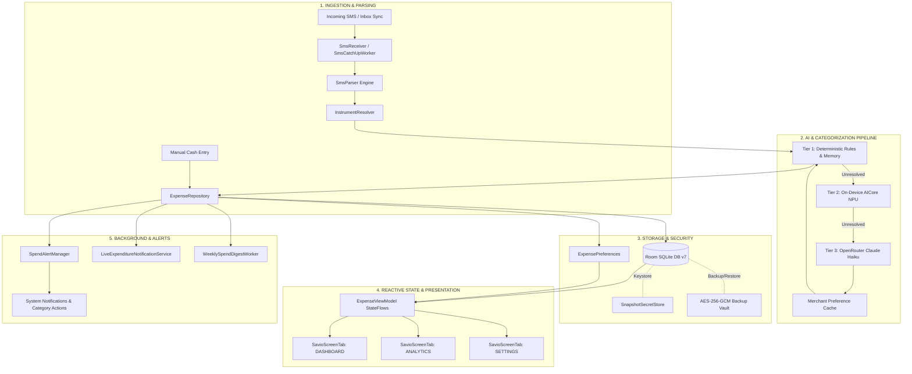

# Savior (Savio₹)


## Privacy-First, Local-First Intelligent SMS Expense Tracker & Financial Intelligence Engine for Android

[-3DDC84?logo=android&logoColor=white)](https://developer.android.com)
[](https://kotlinlang.org)
[](https://developer.android.com/jetpack/compose)
[-4285F4?logo=sqlite&logoColor=white)](https://developer.android.com/training/data-storage/room)
[](#-security-architecture--cryptography)
[](LICENSE)
[-brightgreen)](#-building--testing)

[Key Features](#-key-features) •
[Architecture](#-system-architecture) •
[AI Engine Tiers](#-hybrid-ai-categorization-engine) •
[Security & Privacy](#-security-architecture--cryptography) •
[Getting Started](#-getting-started) •
[Building & Testing](#-building--testing) •
[Project Structure](#-project-structure)

---

## 📖 Overview

**Savior (Savio₹)** is an offline-first, high-performance personal finance tracking and savings acceleration application built natively for Android using modern Jetpack Compose and Material 3.

Unlike conventional spend trackers that compromise user privacy by syncing financial data to third-party cloud servers, Savior operates **100% locally on your device**. It listens to transactional SMS messages emitted by Indian banks, UPI providers, and credit card issuers, instantaneously extracting expenditures, auto-detecting refunds/reversals, and organizing finances into actionable insights—without bank credentials, screen-scraping, or intrusive cloud lock-in.

Savior features a **hybrid multi-tier AI categorization engine**: zero-latency deterministic regex rules on the edge, on-device NPU inference via **Android AICore / Gemini Nano**, and optional high-precision cloud reasoning via **OpenRouter (Claude 5.5 Haiku)** using your own API key.

---

## ✨ Key Features

### ⚡ Real-Time Transactional SMS Processing

- **Sub-Millisecond Parsing**: High-throughput regex engine tuned for Indian banking systems (HDFC, SBI, ICICI, Axis, Kotak, Amex, PNB, IndusInd, Federal Bank, UPI apps like Google Pay, PhonePe, Paytm, and CRED).
- **Comprehensive Transaction Typing**: Automatically classifies transactions into `MERCHANT`, `P2P` (Transfers), `SELF` (Self transfers between own accounts), and `CREDIT_CARD` (Bill payments).
- **Bi-Directional Refund & Reversal Pairing**: Tracks credits and refunds (`isRefundOrReversal`), dynamically deducting refunded amounts from original merchant debits with non-negative clamping.
- **Windowed Duplicate Spend Detection**: Sliding-window heuristic flag (120-second threshold with $\pm20\%$ amount tolerance) detects potential double-debit charges and alerts the user.
- **Background SMS Catch-Up**: Asynchronous, battery-friendly `WorkManager` batch sync pulls historical inbox messages without UI stutter or notification storms.

### 🧠 Hybrid Multi-Tier AI Categorization

- **Tier 1 — Local Deterministic Engine**: Instant classification using regular expressions, user merchant memory, and customizable rule overrides. Zero battery impact and zero network egress.
- **Tier 2 — On-Device Hardware AICore**: Leverages on-device Gemini Nano / Samsung Rubin NPUs on compatible hardware (Google Pixel & Samsung Galaxy) for private, offline contextual understanding.
- **Tier 3 — Cloud LLM (OpenRouter / Claude 3.5 Haiku)**: Optional cloud reasoning for ambiguous merchants. Includes strict circuit-breakers, exponential rate-limit cooldowns, and automatic caching of resolved merchants to SQLite.

### 💳 Instrument Intelligence & Liquidity Management

- **Automatic Instrument Resolution**: Collapses fragmented SMS formats (e.g., `A/CXXXX`, `A/cXXXX`, `Card ••4821`, `Millennia Card`) into unified, canonical payment accounts.
- **Card & Account Clubbing**: Automatically clubs distinct transactions sharing the same last 4 digits into a unified payment instrument.
- **Custom Instrument Rules**: User-configurable bank names, card nicknames, account types, and custom regex markers. Tap-and-hold any instrument chip in the UI to launch the editor.
- **Liquidity Breakdown**: Real-time spending balances grouped across Credit Cards, Savings/Current Accounts, Cash, and Wallets.

### 📊 Deep Analytics & Visualizations

- **Spend Breakup Pie Chart**: Interactive vector pie chart with category slices, monetary totals, and percentage breakdowns.
- **Daily Burndown Velocity Chart**: Visualizes actual daily spending trajectories against ideal burndown slopes based on user-defined monthly budgets.
- **Calendar History & MoM Delta**: Month-by-month financial ledger with integer-arithmetic delta calculations comparing current spend against previous cycles.
- **12-Month Longitudinal Trends**: Trailing spend curve with non-negative clamping and blacklist filtration.
- **Merchant Deep-Dive Sheet**: Drill down into transaction history, average spend frequency, recurring status, and custom category assignments for any individual merchant.

### 🔔 Proactive Spend Radar & Intelligent Alerts

- **Category Budget Guardrails**: Real-time threshold alerts at **80%** (pacing warning) and **100%** (limit reached) of user-defined category limits.
- **Velocity Pacing Alerts**: Detects when mid-month burn rates exceed monthly budget allowances.
- **Statistical Anomaly Spikes**: Flags sudden, anomalous high-value spends diverging from historical trailing medians.
- **Recurring Subscription Radar**: Heuristic cadence analysis identifies active monthly/quarterly subscriptions, bills, and SIPs, dispatching timely reminders with ordinal-accurate dates.
- **Weekly Spend Digest**: Periodic background digest delivering concise spending recaps every Sunday evening.

### 📌 Live Expenditure HUD (Persistent Notification)

- Bounded, event-driven status bar notification showing today's spend, month-to-date total, remaining daily burndown allowance, and active budget pace.
- **1-Tap In-Notification Actions**: Quickly classify unassigned spends into top categories directly from the Android notification drawer.
- **App Shortcuts**: Quick launcher shortcuts for **"Log Cash"** (1-tap cash entry) and **"Sync SMS"** (instant inbox catch-up).

### 🛡️ Privacy & Security Highlights

- **Android Keystore Hardware Protection**: Local database snapshots are encrypted with device-bound symmetric keys backed by Android's hardware security module (`SnapshotSecretStore`).
- **Biometric App Lock**: Integrated `BiometricPrompt` supporting Fingerprint, Face Unlock, and Device PIN/Pattern with configurable auto-lock timeouts (Immediate, 30s, 1m, 5m).
- **Encrypted Backup Vaults**: Portable, AES-256-GCM + GZIP compressed database exports protected by PBKDF2 key derivation (10,000 iterations). Restores verify cryptographic magic headers and payload checksums.
- **Strict Privacy Guarantee**: No third-party analytics, no tracking SDKs, `allowBackup="false"`, and zero data transmission unless explicitly configured for Cloud AI.

### 📑 Reporting & Data Portability

- **Non-Blocking Excel Export**: Generates full multi-tab XML workbooks (`.xls`) completely off the main thread with busy-state indicators, shared seamlessly via Android `FileProvider`.
- **Encrypted JSON Vaults**: Full export and import of transactions, category limits, merchant rules, and payment instrument definitions.

---

## 🏛 System Architecture

Savior is engineered following modern Android architecture guidelines: Clean Architecture principles with **Model-View-ViewModel (MVVM)**, the **Repository Pattern**, and **Unidirectional Data Flow (UDF)** powered by Kotlin Coroutines and Kotlin Flows (`StateFlow`).



### Key Architectural Highlights

- **Scoped Recomposition**: Root screens in `MainActivity.kt` isolate high-frequency transaction updates (`allExpenses`) away from the primary Dashboard. Analytics and Settings StateFlows are scoped strictly within their respective tab contexts.
- **Flow Offloading**: All multi-parametric searches, aggregate statistics, burndown trajectories, and 12-month trend computations are explicitly offloaded to `Dispatchers.Default` using `.flowOn()`, preventing frame drops on 90Hz/120Hz displays.
- **Resource Reusability**: Vector rasterization, date formatters, and calendar instances in list items are static or memoized to avoid garbage collection churn during rapid flings.

---

## 🤖 Hybrid AI Categorization Engine

Savior uses a graceful 3-tier cascade to maximize categorization accuracy while minimizing latency, battery usage, and network consumption:

| Tier | Engine | Latency | Network | Description |
| :--- | :--- | :--- | :--- | :--- |
| **Tier 1** | **Deterministic Local Engine** | `< 1 ms` | ❌ None | Matches against pre-compiled regular expressions, custom merchant rules, and saved category memory. |
| **Tier 2** | **On-Device AICore** | `~ 150 ms` | ❌ None | Uses hardware-accelerated NPU models (`com.google.android.aicore` or `com.samsung.android.rubin.app`) on supported devices. |
| **Tier 3** | **Cloud OpenRouter LLM** | `~ 600 ms` | 🌐 HTTPS | Sends ambiguous merchant snippets to `anthropic/claude-haiku-5.5` (or user-selected model) via OpenRouter API. |

### Cloud AI Safeguards

- **Circuit Breakers**: Suppresses repeated doomed requests on invalid API keys or persistent 4xx/5xx responses during batch scans.
- **Cooldown Timers**: Enforces bounded rate-limit cooldowns to prevent quota exhaustion.
- **Automatic Memory Ingestion**: When the cloud model successfully classifies a merchant, the result is saved to the local SQLite merchant memory, preventing repeated API calls for that merchant.

---

## 🔒 Security Architecture & Cryptography

Savior is engineered with strict financial data protection:

```text
┌─────────────────────────────────────────────────────────────┐
│                    User Interface / Jetpack Compose         │
├─────────────────────────────────────────────────────────────┤
│   [ Biometric Lock Screen: Fingerprint / Face / PIN ]       │
├─────────────────────────────────────────────────────────────┤
│   Room Database (v7)  │   Device Snapshot Secret            │
│   (SQLite on Flash)   │   (Android Keystore Hardware Key)   │
├───────────────────────┴─────────────────────────────────────┤
│   Encrypted Vault Export:                                   │
│   JSON Payload ➔ GZIP Stream ➔ AES-256-GCM (PBKDF2 Key)     │
└─────────────────────────────────────────────────────────────┘
```

1. **Hardware-Backed Device Secrets**: Local database backups and snapshots are sealed using AES-256 keys generated in the **Android Keystore provider**, preventing keys from being extracted even on rooted devices.
2. **Biometric Session Guard**: Authentication state is checked on application resume. Cryptographic sessions are cleared upon timeout or backgrounding.
3. **Encrypted Vault Portability**: Encrypted backup archives utilize PBKDF2 with 10,000 hash iterations and salt generation, encrypted via authenticated AES-GCM with SHA-256 verification.
4. **Zero-Tracking Manifest**: The app does not declare advertising IDs, Firebase Analytics, or location permissions.

---

## 📁 Project Structure

```text
savior/
├── app/
│   ├── src/
│   │   ├── main/
│   │   │   ├── AndroidManifest.xml        # Declarations, services, receivers, queries
│   │   │   ├── java/com/example/
│   │   │   │   ├── MainActivity.kt        # Primary Compose host, navigation, sheets
│   │   │   │   ├── SpendTrackerApplication.kt # Application lifecycle, WorkManager init
│   │   │   │   ├── ai/                    # Hybrid AI engines (AICore, OpenRouter)
│   │   │   │   │   ├── AiCoreCategorizer.kt
│   │   │   │   │   ├── CloudRequestSession.kt
│   │   │   │   │   ├── OpenRouterCategorizer.kt
│   │   │   │   │   └── OpenRouterClient.kt
│   │   │   │   ├── data/                  # Room v7 entities, DAOs, repository, prefs
│   │   │   │   │   ├── AppDatabase.kt
│   │   │   │   │   ├── ExpenseDao.kt
│   │   │   │   │   ├── ExpenseEntity.kt
│   │   │   │   │   ├── ExpensePreferences.kt
│   │   │   │   │   ├── ExpenseRepository.kt
│   │   │   │   │   ├── ExpenseType.kt
│   │   │   │   │   ├── InstrumentRuleDao.kt
│   │   │   │   │   └── MerchantRuleDao.kt
│   │   │   │   ├── engine/                # Heuristic engines (recurring commitments)
│   │   │   │   │   └── RecurringDetectionEngine.kt
│   │   │   │   ├── receiver/              # BroadcastReceivers (SMS, Boot, Actions)
│   │   │   │   │   ├── BootReceiver.kt
│   │   │   │   │   ├── CategoryActionReceiver.kt
│   │   │   │   └── security/              # Android Keystore & Biometric managers
│   │   │   │   │   ├── AppSecurityManager.kt
│   │   │   │   │   └── SnapshotSecretStore.kt
│   │   │   │   ├── service/               # Foreground services, alert managers, workers
│   │   │   │   │   ├── ExpenseProcessingHelper.kt
│   │   │   │   │   ├── LiveExpenditureNotificationService.kt
│   │   │   │   │   ├── NotificationRefreshWorker.kt
│   │   │   │   │   ├── SmsCatchUpWorker.kt
│   │   │   │   │   ├── SpendAlertManager.kt
│   │   │   │   │   └── WeeklySpendDigestWorker.kt
│   │   │   │   ├── sms/                   # SMS reading, regex parsing, mock datasets
│   │   │   │   │   ├── ParsedSms.kt
│   │   │   │   │   ├── SampleSmsData.kt
│   │   │   │   │   ├── SmsParser.kt
│   │   │   │   │   └── SmsReader.kt
│   │   │   │   ├── ui/                    # Compose UI components, themes, ViewModel
│   │   │   │   │   ├── ExpenseViewModel.kt
│   │   │   │   │   ├── components/        # Charts, sheets, item cards, dialogs
│   │   │   │   │   │   ├── AssignCategoryDialog.kt
│   │   │   │   │   │   ├── BiometricLockOverlay.kt
│   │   │   │   │   │   ├── CalendarAnalyticsTab.kt
│   │   │   │   │   │   ├── DailyBurnDownChart.kt
│   │   │   │   │   │   ├── ExpenditureHeroCard.kt
│   │   │   │   │   │   ├── InstrumentEditorSheet.kt
│   │   │   │   │   │   ├── InstrumentLiquidityCard.kt
│   │   │   │   │   │   ├── MerchantDetailSheet.kt
│   │   │   │   │   │   ├── RecurringCommitmentsSheet.kt
│   │   │   │   │   │   ├── SettingsScreen.kt
│   │   │   │   │   │   ├── SpendBreakupPieChartCard.kt
│   │   │   │   │   │   └── TransactionItemCard.kt
│   │   │   │   │   └── theme/             # Material 3 colors, shapes, typography
│   │   │   │   └── util/                  # Backup vaults, Excel exporter, InstrumentResolver
│   │   │   │       ├── DatabaseBackupHelper.kt
│   │   │   │       ├── ExcelExportHelper.kt
│   │   │   │       └── InstrumentResolver.kt
│   │   │   └── res/                       # Drawables, layouts, mipmaps, XML configurations
│   │   └── test/                          # Unit, Robolectric, and Roborazzi tests
│   └── build.gradle.kts                   # App module build definition
├── gradle/
│   └── libs.versions.toml                 # Version catalog
├── public/                                # Verified release APK builds & checksums
│   ├── savior-2.5.apk
│   └── savior-2.5.apk.sha256
├── AGENTS.md                              # Codebase optimization & sanitization log
├── RELEASE_NOTES_v2.5.md                  # Release notes & benchmark evidence
├── build.gradle.kts                       # Root build configuration
└── settings.gradle.kts                    # Gradle settings
```

---

## 🚀 Getting Started

### Prerequisites

- **Android Studio**: Ladybug (2024.2.1+) or newer.
- **Java Development Kit**: JDK 11 or JDK 17.
- **Android SDK**: `compileSdk = 36`, `minSdk = 24` (Android 7.0 Nougat to Android 15/16).
- **Physical Device or Emulator**: For SMS testing, physical devices with SIM cards are recommended; the app also includes a built-in **"Test SMS Bottom Sheet"** with mock data for emulators.

### Clone the Repository

```bash
git clone https://github.com/schultz911/savior.git
cd savior
```

### Environment Configuration (Optional)

If you wish to use Gemini AI features via AI Studio secrets or an OpenRouter key:

```bash
cp .env.example .env
```

Uncomment and edit the keys in `.env`:

```properties
# GEMINI_API_KEY=your_gemini_api_key_here
```

*(Note: Cloud AI keys can also be directly input in the app under **Settings ➔ AI Categorization Engine** without recompiling.)*

---

## 🛠 Building & Testing

### Building Debug APK

```bash
# On Linux/macOS
./gradlew assembleDebug

# On Windows PowerShell
.\gradlew.bat assembleDebug
```

The output APK will be placed at `app/build/outputs/apk/debug/app-debug.apk`.

### Building Release APK

The project includes automated R8 minification, resource shrinking, and ProGuard optimization:

```bash
# On Linux/macOS
./gradlew assembleRelease

# On Windows PowerShell
.\gradlew.bat assembleRelease
```

The release APK will be placed at `app/build/outputs/apk/release/app-release.apk`.

### Running Unit & Screenshot Tests

Savior maintains strict test coverage across Room migrations, SMS parsing, security protocols, and screenshot UI fidelity via **Robolectric** and **Roborazzi**:

```bash
# Run all unit and Robolectric tests (87 tests)
./gradlew testDebugUnitTest

# Verify Roborazzi Compose screenshot regressions
./gradlew verifyRoborazziDebug
```

---

## 📦 Verified Pre-Built APK

Verified, ready-to-install binaries are stored in the repository root and `public/`:

| Version | APK File | Size | SHA-256 Checksum |
| :--- | :--- | :--- | :--- |
| **v2.5** *(Current)* | [`public/savior-2.5.apk`](public/savior-2.5.apk) | `4.47 MB` | `d8a530668fcaa72598aebb392f0cf32ade10b32302c0cbdbc8a91ab29d6b783a` |
| **v2.1** *(Rollback)* | [`public/savior-2.1.apk`](public/savior-2.1.apk) | `4.46 MB` | Retained for regression rollback |

To verify the checksum on Windows PowerShell:

```powershell
Get-FileHash -Algorithm SHA256 .\public\savior-2.5.apk
```

To install directly to a connected device via ADB:

```bash
adb install -r public/savior-2.5.apk
```

---

## 🛡 Permissions Overview

Savior requests only the permissions strictly required to perform local expenditure tracking:

| Permission | Necessity | Privacy Rationale |
| :--- | :--- | :--- |
| `RECEIVE_SMS` | Core Feature | Intercepts incoming transactional bank alerts in real time. |
| `READ_SMS` | Core Feature | Syncs historical transactions from your inbox upon first launch or explicit manual sync. |
| `POST_NOTIFICATIONS` | Alerts & HUD | Displays budget alerts, duplicate spend warnings, and the live expenditure HUD. |
| `RECEIVE_BOOT_COMPLETED` | Background Sync | Restores the live notification HUD and scheduled recurring bill checks after device reboot. |
| `REQUEST_IGNORE_BATTERY_OPTIMIZATIONS` | Optional | Prevents aggressive OEM background task termination for real-time alerts. |
| `INTERNET` | Optional | Used **only** if the user configures an OpenRouter API key for Cloud AI categorization. |

Savior explicitly does **not** request contacts, storage (uses scoped app cache and Storage Access Framework), microphone, location, or broad package visibility queries.

---

## 🤝 Contributing

Contributions, issues, and feature requests are welcome!

1. Fork the Project.
2. Create your Feature Branch (`git checkout -b feature/AmazingFeature`).
3. Commit your Changes (`git commit -m 'Add some AmazingFeature'`).
4. Ensure all unit and screenshot tests pass (`./gradlew testDebugUnitTest`).
5. Check optimization guidelines in [`AGENTS.md`](AGENTS.md).
6. Push to the Branch (`git push origin feature/AmazingFeature`).
7. Open a Pull Request.

---

## 📄 License

Distributed under the Apache License 2.0. See `LICENSE` for more information.

---

*Crafted with ❤️ for privacy-conscious financial freedom.*
